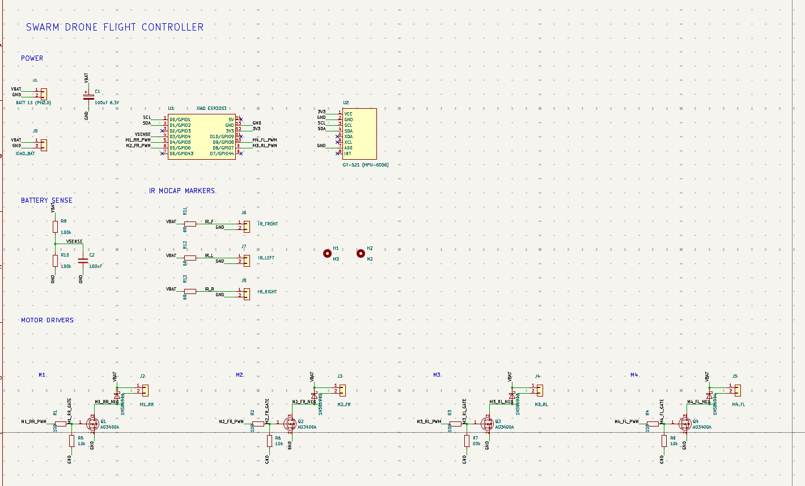
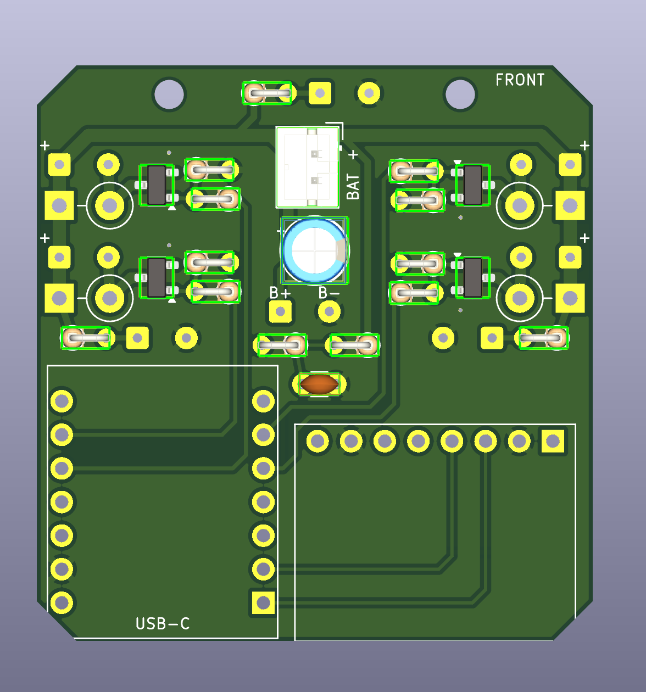

# swarm-drone
A small swarm of cheap quadcopters that fly inside a motion-capture rig built from USB cameras. It's based on Joshua Bird's Low-Cost-Mocap, and I've changed a lot of it with max imagination esp-fly drone.

It all started when I watched a video on a drone light show. I was honestly amazed by how so many drones could fly together and make those cool patterns. I don't know much about drones at all, so naturally I researched a little. I started looking into how to make a few drones and make a lighting show like that, but found out it's not as simple as it looks and took up this challenge.

First I started with the normal generic drone people build in videos with generic motors, but after a quick BOM I found out it costs way too much. After some searching I found this ESP mini drone which I wanted to build, but I didn't know how to do the lighting show, so I went online looking for cheaper alternatives and found a cool repo by Joshua Bird (Low-Cost-Mocap) where he uses PS3 cameras to get the position of an ESP drone. That is cheap and could achieve my aim, so I started building this project.

## How it works

Two cameras watch three infrared LEDs on each drone. The Python backend in Mocap/computer_code/api/ finds the LED spots, works out where each drone is and which way it faces, and smooths the result with a Kalman filter. A ground ESP32 runs the position and velocity PIDs and sends stick commands to each drone over ESP-NOW. Each drone runs ESP-FC, so the flight controller handles the motors.

## 3D Model

## Schematics

## PCB

### Assembled

## BOM
| Item | Quantity | Price (INR) | Price (USD) | Link |
|---|---|---|---|---|
| Seeed XIAO ESP32-S3 | 2 | ₹2278.00 | $23.98 | [Link](https://robu.in/product/seeed-studio-xiao-esp32s3-2-4ghz-wifi-ble-5-0/) |
| GY-521 MPU-6050 IMU | 2 | ₹254.00 | $2.68 | [Link](https://quartzcomponents.com/products/mpu6050-gyroscope-accelerometer-sensor) |
| AO3400 MOSFET (SOT-23) | 15 | ₹90.00 | $0.96 | [Link](https://quartzcomponents.com/products/ao3400-mosfet-30v-5-8a-a09t-sot-23-c-n-channel-smd-package) |
| 1N5819 Schottky Diode | 15 | ₹45.00 | $0.48 | [Link](https://quartzcomponents.com/products/1n5819-shottky-barrier-diode) |
| 100Ω Resistor | 20 | ₹14.00 | $0.14 | [Link](https://quartzcomponents.com/products/100-ohm-1-4-watt-resistor) |
| 10kΩ Resistor | 20 | ₹14.00 | $0.14 | [Link](https://quartzcomponents.com/products/10k-ohm-1-4-watt-resistor) |
| 100kΩ Resistor | 10 | ₹6.00 | $0.06 | [Link](https://quartzcomponents.com/products/100k-ohm-1-4-watt-resistor) |
| 68Ω Resistor | 20 | ₹14.00 | $0.14 | [Link](https://quartzcomponents.com/products/68-ohm-1-4-watt-resistor-with-5-tolerance-pack-of-10) |
| 100µF Capacitor | 2 | ₹6.00 | $0.06 | [Link](https://quartzcomponents.com/products/100uf-25v-radial-electrolytic-capacitor) |
| 100nF Ceramic Capacitor | 25 | ₹19.00 | $0.20 | [Link](https://makerbazar.in/products/ceramic-capacitor) |
| MX2.0 Battery Connector (with wire) | 2 | ₹78.00 | $0.82 | [Link](https://makerbazar.in/products/mx-pair-connector-with-wire-2-0mm-battery-charging-cable) |
| Male Header Pins (40 pin strip) | 2 | ₹14.00 | $0.15 | [Link](https://quartzcomponents.com/products/40-pin-break-away-headers-straight-male-headers) |
| 720 Coreless Motors (2 CW + 2 CCW, with props) | 12 | ₹537.00 | $5.64 | [Link](https://makerbazar.in/products/magnetic-micro-coreless-motor-for-drones-quadcopters-rc-1) |
| 55mm Propellers | 4 | ₹39.00 | $0.41 | [Link](https://makerbazar.in/products/4pcs-55mm-mini-drone-propeller-set-cw-ccw-coreless-motor) |
| 1S LiPo 400mAh 30C | 3 | ₹711.00 | $7.47 | [Link](https://quartzcomponents.com/products/3-7v-30c-400mah-lithium-polymer-lipo-battery-yy702030) |
| 3mm IR LED | 12 | ₹60.00 | $0.63 | [Link](https://quartzcomponents.com/products/3mm-ir-transmitter-led) |
| TP4056 Charger Module | 1 | ₹18.00 | $0.19 | [Link](https://quartzcomponents.com/products/tp4056-battery-charging-protection-module-type-c) |
| 3.3kΩ Resistor | 10 | ₹7.00 | $0.07 | [Link](https://quartzcomponents.com/products/3-3k-ohm-1-4-watt-resistor) |
| M2 x 6mm Screws | 8 | ₹16.00 | $0.16 | [Link](https://quartzcomponents.com/products/m2-x-6mm-pan-head-phillips-screw-pack-of-4) |
| Double-Sided Foam Tape | 1 | ₹23.00 | $0.24 | [Link](https://quartzcomponents.com/products/white-sponge-double-sided-acrylic-foam-adhesive-tapes) |
| LiPo Battery Strap | 2 | ₹116.00 | $1.22 | [Link](https://robu.in/product/20cm-lipo-battery-strap-belt-reusable-cable-tie-wrap/) |
| 30AWG Silicone Wire Red (1m) | 1 | ₹16.00 | $0.17 | [Link](https://quartzcomponents.com/products/30awg-silicone-wire-red-1-meter-high-quality-ultra-flexible-wires) |
| 30AWG Silicone Wire Black (1m) | 1 | ₹16.00 | $0.17 | [Link](https://quartzcomponents.com/products/30awg-silicone-wire-black-1-meter-high-quality-ultra-flexible-wire) |
| Sony PlayStation 3 Eye Camera (used) | 2 | ₹1710.00 | $18.00 | [Link](https://www.ebay.com/itm/166793845723) |
| 850nm IR Bandpass Filter (replaces camera IR-cut filter) | 2 | ₹1710.00 | $18.00 | [Link](https://commonlands.com/products/850nm-bandpass-filter) |
| 12V 5A 60W Power Supply with 5.5mm DC Plug | 1 | ₹425.00 | $4.47 | [Link](https://robocraze.com/products/kento-g-12v-power-adapter-5a-60w-with-5-5mm-dc-plug-standard-ac-to-dc-power-supply) |
| Official Raspberry Pi USB 3.0 Hub | 1 | ₹1191.00 | $12.54 | [Link](https://robocraze.com/products/official-raspberry-pi-usb-3-hub) |
| shipping  | 1 | ₹1367.00 | $14.38 |  |
| PCB Manufacturing | 5 | ₹1000.00 | $10.53 | [Link](https://robu.in/product/online-pcb-manufacturing-service/) |
| **TOTAL** |  | **₹11794.00** | **$124.10** |  |

