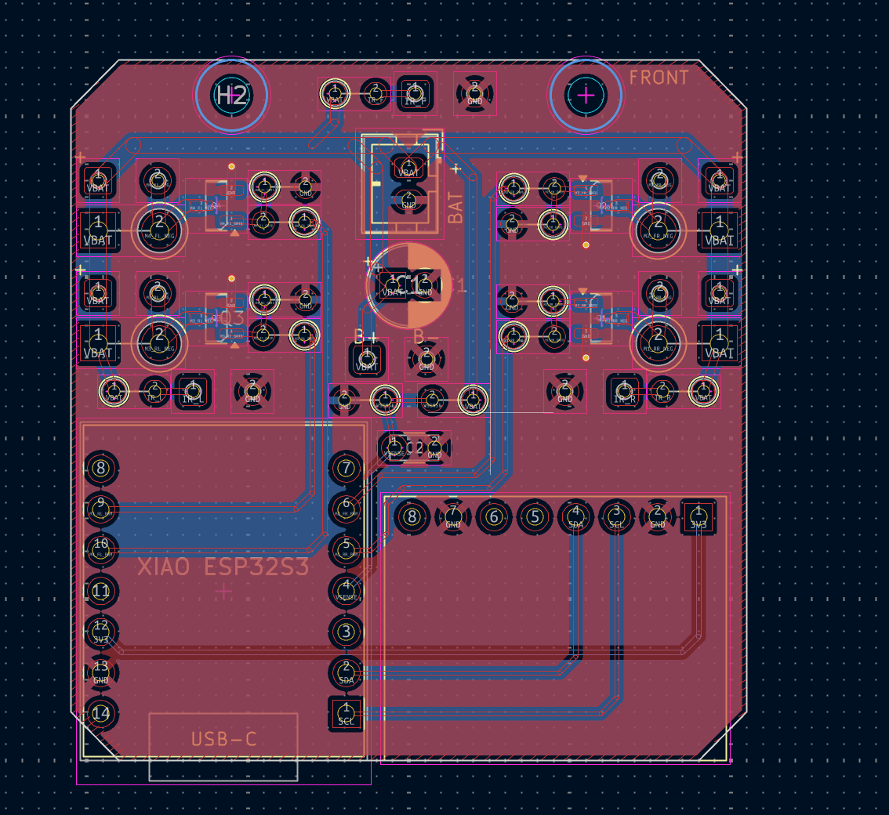

# swarm-drone
A small swarm of cheap quadcopters that fly inside a motion-capture rig built from USB cameras. It's based on Joshua Bird's Low-Cost-Mocap, and I've changed a lot of it with max imagination esp-fly drone.

It all started when I watched a video on a drone light show. I was honestly amazed by how so many drones could fly together and make those cool patterns. I don't know much about drones at all, so naturally I researched a little. I started looking into how to make a few drones and make a lighting show like that, but found out it's not as simple as it looks and took up this challenge.

First I started with the normal generic drone people build in videos with generic motors, but after a quick BOM I found out it costs way too much. After some searching I found this ESP mini drone which I wanted to build, but I didn't know how to do the lighting show, so I went online looking for cheaper alternatives and found a cool repo by Joshua Bird (Low-Cost-Mocap) where he uses PS3 cameras to get the position of an ESP drone. That is cheap and could achieve my aim, so I started building this project.

## How it works

Two cameras watch three infrared LEDs on each drone. The Python backend in Mocap/computer_code/api/ finds the LED spots, works out where each drone is and which way it faces, and smooths the result with a Kalman filter. A ground ESP32 runs the position and velocity PIDs and sends stick commands to each drone over ESP-NOW. Each drone runs ESP-FC, so the flight controller handles the motors.

## 3D Model

## Schematics

## PCB

### Assembled

